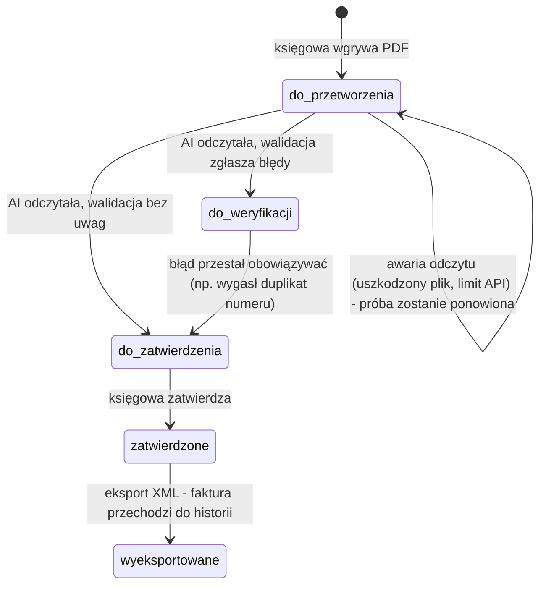
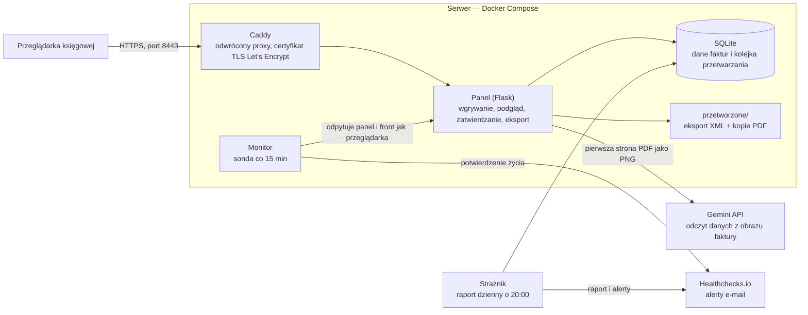

<p align="center"></p>

# Omega Faktury

**System automatycznego czytania i walidacji faktur dla biura rachunkowego.**
Księgowa wgrywa faktury w formacie PDF, model sztucznej inteligencji odczytuje z
nich dane, system sprawdza ich poprawność regułami księgowymi, a po akceptacji
człowieka przygotowuje eksport w formacie XML (wraz z kompletami PDF) gotowy do
importu w systemie księgowym — docelowo Comarch Optima.

Technologie: Python 3.12 · Flask · Gemini API · PyMuPDF · SQLite · Docker
Compose · Caddy · GitHub Actions · Healthchecks.io

---

## Jaki problem rozwiązuje

W typowym biurze rachunkowym dane z faktur wprowadza się ręcznie: ktoś
przepisuje numery, NIP-y, daty i kwoty z papieru lub PDF-a do systemu
księgowego. To jest wolne, łatwo o literówkę w numerze albo przepisanie
kwoty, a ta sama faktura potrafi przyjść dwa razy. Weryfikacja takich
błędów zależy w całości od uwagi człowieka.

Ten system przejmuje mechaniczną część tej pracy: odczytuje dane z
dokumentu, krzyżowo sprawdza kwoty, NIP-y i daty, pilnuje numerów
duplikatów i podaje wszystko księgowej do podjęcia decyzji. Człowiek
zatwierdza — ale zatwierdza dokument już przeczytany i sprawdzony,
zamiast sam go przepisywać.

## Jak wygląda praca z systemem

1. **Wgrywanie.** Księgowa loguje się do panelu w przeglądarce i wybiera
   faktury — pojedynczo („Wybierz faktury…") albo cały folder naraz
   („Wybierz folder…"). Każdy PDF od razu dostaje wiersz w kolejce i jest
   przetwarzany w tle; lista faktur odświeża się na żywo.
2. **Odczyt przez AI.** Model analizuje obraz pierwszej strony faktury i
   zwraca ustrukturyzowane dane: numer, sprzedawcę i nabywcę z NIP-ami,
   daty, kwoty netto/VAT/brutto oraz wszystkie pozycje tabeli. Dokument
   czytany jest jako obraz, więc faktura obrócona o 90 stopni (zdjęcie z
   telefonu) czy skan słabej jakości nie wymagają osobnej obsługi.
3. **Walidacja.** System sprawdza odczytane dane regułami opisanymi
   niżej. Faktura bez uwag trafia do zakładki „Do zatwierdzenia",
   faktura z błędami — do zakładki „Błędy" z konkretnym opisem, co się
   nie zgadza.
4. **Decyzja człowieka.** W podglądzie księgowa widzi wyekstrahowane
   dane i pozycje obok oryginalnego PDF-a. Poprawną fakturę zatwierdza
   jednym kliknięciem; przy fakturze z błędami podejmuje decyzję — np.
   prosi dostawcę o korektę dokumentu.
5. **Eksport.** Przycisk „Eksportuj do XML" w zakładce „Zatwierdzone"
   tworzy plik XML z danymi wszystkich zatwierdzonych faktur oraz kopie
   PDF-ów o czytelnych nazwach (`data_numer_kontrahent.pdf`).
   Wyeksportowane faktury przechodzą do historii i znikają z bieżącego
   widoku.

Droga faktury przez system — cykl życia statusów:



## Co system sprawdza na każdej fakturze

- **NIP sprzedawcy** — jest obecny, składa się z dokładnie 10 cyfr i
  przechodzi oficjalną sumę kontrolną.
- **Kwoty** — netto + VAT = brutto (z tolerancją 1 grosza na
  zaokrąglenia) oraz suma wartości netto pozycji zgadza się z kwotą
  „razem netto" faktury.
- **Daty** — termin płatności nie jest wcześniejszy niż data
  wystawienia.
- **Duplikaty** — ten sam numer faktury nie może wystąpić dwukrotnie
  wśród bieżących faktur ani powtórzyć faktury już wyeksportowanej
  wcześniej. Duplikat jest zawsze widocznym błędem do decyzji księgowej,
  nigdy cichym nadpisaniem.
- **Powtórne wgranie** — identyczna treść pliku (odcisk SHA-256) nie
  jest przetwarzana (i rozliczana w API) drugi raz.

## Skuteczność odczytu

System ma wbudowany mechanizm pomiaru dokładności: porównuje wyniki
ekstrakcji z wzorcowymi danymi (tzw. ground truth) i zapisuje raport do
`data/raport_dokladnosci.json`. Na przygotowanym zbiorze testowym — 20
wygenerowanych faktur, w tym 12 poprawnych i 8 z celowo wprowadzonymi
defektami (obrót dokumentu, skan bardzo słabej jakości, brak NIP-u
sprzedawcy, niezgodne kwoty, termin płatności przed datą wystawienia) —
system osiągnął:

- **98,4%** poprawnie odczytanych pól danych (numer, NIP, daty, kwoty),
- **88,9%** zgodności oceny walidacji z oczekiwaną (czy system słusznie
  zgłosił błąd na wadliwym dokumencie — i słusznie nie zgłosił na
  poprawnym).

## Architektura



| Komponent | Plik | Rola |
| --- | --- | --- |
| Panel | `panel.py` | serwer webowy: logowanie, wgrywanie PDF-ów, podgląd danych obok oryginału, zatwierdzanie, eksport; przetwarzanie kolejki w tle |
| Silnik przetwarzania | `weryfikator.py` | renderowanie PDF do obrazu, zapytanie do Gemini z sztywnym schematem JSON, reguły walidacji, raporty |
| Baza danych | `baza.py` | SQLite — schemat, migracje, kolejka przetwarzania, statusy, wykrywanie duplikatów |
| Eksport | `eksport.py` | XML w formacie OmegaProcessor + kopie PDF-ów o nazwach `data_numer_kontrahent.pdf` |
| Monitor | `monitor.py` | sonda życia co 15 minut (panel i front) + ping do Healthchecks.io |
| Strażnik | `straznik.py` | raport dzienny o 20:00 i cztery alerty progowe |
| Nakładka desktopowa | `desktop.py` | panel w natywnym oknie (pywebview), do pracy lokalnej |
| Generator testowy | `generator.py` | tworzy fikcyjne faktury z celowymi defektami + dane wzorcowe do pomiaru dokładności |

### Kluczowe decyzje projektowe

- **Model wizyjny zamiast parsera tekstu.** Faktury od różnych dostawców
  mają różne układy, a warstwa tekstowa PDF bywa wadliwa (błędny OCR).
  Model czyta obraz strony i zwraca odpowiedź w sztywnym schemacie JSON
  przy zerowej „kreatywności" (temperature=0), więc wynik jest
  deterministyczny i od razu gotowy do walidacji — bez parsowania
  dowolnego tekstu.
- **SQLite jako jedyny magazyn i kolejka.** Każdy wgrany PDF to wiersz
  w bazie; wyniki zapisywane są na bieżąco, więc przerwane przetwarzanie
  (restart serwera, awaria API) wznawia się samo od miejsca, w którym
  stanęło. Zero dodatkowej infrastruktury do utrzymywania.
- **Człowiek zatwierdza, system eksportuje.** Sztuczna inteligencja
  odczytuje i sprawdza, ale do eksportu trafia wyłącznie to, co księgowa
  zaakceptowała. Akceptacja człowieka jest trwała — system nigdy nie
  nadpisze zatwierdzonej faktury.
- **Odporność na awarie.** Chwilowe błędy API (limity, przeciążenie) są
  ponawiane automatycznie; faktura, której nie udało się odczytać,
  czeka w kolejce z opisem błędu i zostanie podjęta ponownie — nic nie
  ginie po cichej stronie.

## Bezpieczeństwo

- **Szyfrowanie.** Cały ruch — hasła, faktury, PDF-y — idzie po HTTPS z
  prawdziwym certyfikatem Let's Encrypt. Przeglądarka nie pokazuje
  ostrzeżeń. Port panelu 5000 nie istnieje z zewnątrz; jedyne okno na
  świat to Caddy na porcie 8443.
- **Konta.** Logowanie na login i hasło; w konfiguracji trzymany jest
  wyłącznie hash hasła (scrypt), nigdy jawne hasło. Pięć błędnych prób
  logowania z jednego adresu IP blokuje dostęp na 15 minut. Sesja
  wygasa po 8 godzinach, ciasteczko jest HttpOnly i SameSite=Lax.
- **Jedna brama dla wszystkiego.** Strony, API, podgląd PDF-ów i plik
  eksportu przechodzą przez ten sam mechanizm autoryzacji — osoba
  wylogowana nie dobierze się do danych nawet bezpośrednim zapytaniem
  HTTP.
- **Sekrety.** Klucze (API Gemini, tokeny, hashe haseł) żyją wyłącznie
  w pliku `.env` na serwerze — nie trafiają do obrazu Dockera ani do
  repozytorium. Kontener proxy celowo nie dostaje klucza Gemini.
- **Kontener.** Aplikacja działa w kontenerze bez uprawnień roota,
  z rotacją logów, i wstaje sama po restarcie maszyny.

## Niezawodność i monitoring

Trzy niezależne warstwy, tak aby awaria była widoczna jeszcze zanim
zauważy ją księgowa:

1. **Auto-restart** — Docker restartuje padnięty proces, a healthcheck w
   obrazie pilnuje, że panel realnie odpowiada.
2. **Monitor (co 15 minut)** — osobny kontener odpytuje panel i front
   dokładnie tak, jak robi to przeglądarka księgowej. Po udanej
   odpowiedzi wysyła potwierdzenie życia do Healthchecks.io; gdy
   potwierdzeń zabraknie (zawieszony panel, pad serwera, wygasły
   certyfikat), Healthchecks wysyła e-mail.
3. **Strażnik (codziennie o 20:00)** — raport dnia (ile przetworzono,
   ile czeka, ile wyeksportowano) plus cztery alerty progowe: kolejka
   stoi dłużej niż 4 godziny, błędów przybywa dzień po dniu,
   skuteczność odczytu spadła o co najmniej 15 punktów procentowych,
   w kolejce czekają faktury z błędami API. Aktywny alarm natychmiast
   wysyła e-mail.

Przepisy reakcji na każdy alert znajdują się w [RUNBOOK.md](RUNBOOK.md).

## Demonstracja (film w przygotowaniu)

Planowane jest krótkie nagranie pokazujące system w działaniu; ta sekcja
będzie je zawierać. Proponowany scenariusz nagrania, który pokazuje
pełny cykl w około dwie minuty:

1. Logowanie do panelu na działającym wdrożeniu
   `https://omega-faktury.duckdns.org:8443`.
2. Wgranie trzech faktur naraz, w tym obróconej o 90 stopni i jednej z
   niezgodnymi kwotami — widać kolejkę i przetwarzanie w tle.
3. Zakładka „Błędy": podgląd danych obok oryginalnego PDF-a, czerwony
   opis, co się nie zgadza.
4. Zakładka „Do zatwierdzenia": zatwierdzenie poprawnych faktur jednym
   kliknięciem.
5. Zakładka „Zatwierdzone": „Eksportuj do XML", pokazanie pliku XML i
   PDF-ów o nazwach `data_numer_kontrahent.pdf`.
6. Na zakończenie: przykładowy raport dzienny strażnika.

## Planowane kierunki rozwoju

- **Pobieranie faktur ze skrzynki e-mail** (IMAP) — faktury przychodziłyby
  do systemu bez ręcznego wgrywania.
- **Automatyczna klasyfikacja księgowa** — dzisiaj pole `Kategoria`
  w eksporcie ma wartość domyślną; docelowo miałaby ją nadawać AI.
- **Import w Comarch Optima** — format XML jest przygotowany pod import;
  kolejnym krokiem jest jego walidacja u docelowego systemu.

---

# Część operacyjna (dla administratora)

## Wdrożenie na serwerze

Wymagania: serwer z Dockerem (z wtyczką compose), klucz API Gemini z
Google AI Studio, dowolna domena wskazująca na adres serwera (wystarczy
darmowa z Duck DNS) oraz — opcjonalnie, do monitoringu — konto na
Healthchecks.io. Porty 80/443 nie są potrzebne: certyfikat jest
pozyskiwany wyzwaniem DNS-01, a panel działa na porcie 8443.

Konfiguracja to jeden plik `.env` obok `docker-compose.yml` (szablon:
`.env.example`). Trzy generatory wartości:

```bash
python -c "import secrets; print(secrets.token_hex(32))"    # SECRET_KEY (sesje)
python -c "import secrets; print(secrets.token_urlsafe(32))" # PANEL_TOKEN (monitor)
python -c "from werkzeug.security import generate_password_hash as g; print('ksiegowa=' + g(input('Hasło: ')))"
# ^ uruchom dla każdego konta, wyniki sklej średnikiem w PANEL_KONTA
```

Kluczowe pułapki konfiguracji:

- `PANEL_KONTA` musi być w **pojedynczych** cudzysłowach — hash werkzeuga
  zawiera `$`, a docker compose w wartościach bez cudzysłowów i w
  podwójnych cudzysłowach traktuje `$coś` jako zmienną i zamienia ją na
  pusty ciąg (logowanie wtedy odrzuca dobre hasło).
- `DOMENA` to nazwa, pod którą panel jest osiągalny: na serwerze domena
  wskazująca na jego publiczne IP, lokalnie do testów `localhost`
  (Caddy wystawia wtedy certyfikat ze swojego wewnętrznego CA i token
  Duck DNS może być pusty).
- Puste `PANEL_KONTA` wyłącza logowanie (tryb deweloperski) — na
  serwerze zawsze ustawione.

Start i codzienne operacje:

```bash
docker compose up -d            # start: panel + caddy + monitor
docker compose logs -f panel    # podgląd logów
docker compose down             # stop (dane w ./data i ./przetworzone zostają)
docker compose run --rm straznik  # ręczny raport dzienny
```

Na starcie serwer sam dokańcza kolejkę faktur przerwanych przy
restarcie. Folder `./data/` to magazyn plików panelu — nowe faktury
wgrywa się w panelu, nie przez kopiowanie do tego folderu.

### Monitoring — konfiguracja jednorazowa (ok. 5 minut)

1. W Healthchecks.io utwórz dwa checki: `monitor` (okres 15 minut,
   grace 45 minut) oraz `strażnik` (cron `0 20 * * *`, grace 30 minut),
   z własnym adresem e-mail do powiadomień.
2. Adresy pingu obu checków dopisz do `.env` jako `HEALTHCHECKS_URL`
   i `HEALTHCHECKS_STRAZNIK_URL`.
3. Na serwerze dodaj do crontaba (`crontab -e`) uruchomienie strażnika:

   ```
   0 20 * * * cd /ścieżka/do/omega-invoce-pipeline && docker compose run --rm straznik
   ```

4. `docker compose up -d --build` — od tej chwili w Healthchecks
   pojawiają się pingi co 15 minut (treść z licznikami widać w historii
   pingu). Raporty strażnika lądują też w `./logi/straznik_RRRR-MM-DD.txt`.

Wszystkie zmienne monitoringu są opcjonalne: bez nich monitor i strażnik
działają, ale nie wysyłają nic na zewnątrz.

### Wdrażanie nowych wersji

Repozytorium ma gotowy workflow GitHub Actions (`.github/workflows/
deploy.yml`): każdy push do gałęzi `main` loguje się przez SSH na
serwer, pobiera nowy kod, przebudowuje obrazy i restartuje usługi.
Wymaga sekretów `SSH_PRIVATE_KEY`, `VPS_HOST` i `VPS_USER` w ustawieniach
repozytorium.

## Uruchomienie lokalne (bez serwera)

Instalacja zależności: `uv sync` (albo `pip install .`). Python 3.12.

- `python panel.py` — panel w przeglądarce pod `http://127.0.0.1:5000`.
  Przy pustym `PANEL_KONTA` logowanie jest wyłączone; przy braku
  `GEMINI_API_KEY` panel działa, ale wgrane faktury czekają w kolejce.
- `python desktop.py` — panel w natywnym oknie (wymaga doinstalowania
  `pywebview`, celowo poza zależnościami projektu).
- `python weryfikator.py` — jednorazowy przebieg batcha w konsoli:
  przetwarza kolejkę, wypisuje raport i porównanie z danymi wzorcowymi.
- `python generator.py` — tworzy 20 fikcyjnych faktur testowych
  (wymaga doinstalowania `reportlab` i `pillow`, również celowo poza
  zależnościami).

## Struktura repozytorium

| Ścieżka | Zawartość |
| --- | --- |
| `panel.py`, `weryfikator.py`, `baza.py`, `eksport.py` | aplikacja właściwa (panel, silnik AI, baza, eksport) |
| `monitor.py`, `straznik.py` | monitoring: sonda życia i raport dzienny z alertami |
| `desktop.py`, `generator.py` | narzędzia lokalne: nakładka okienkowa, generator faktur testowych |
| `templates/` | interfejs panelu i strona logowania (HTML/CSS/JS) |
| `data/` | PDF-y faktur, baza SQLite, raporty — volume, nie część obrazu |
| `przetworzone/` | wyniki eksportu: pliki XML i kopie PDF-ów |
| `Dockerfile`, `Dockerfile.caddy`, `docker-compose.yml`, `Caddyfile` | konteneryzacja i proxy TLS |
| `.github/workflows/deploy.yml` | automatyczny deploy na serwer po pushu do main |
| `.env.example` | szablon konfiguracji z instrukcjami |
| `RUNBOOK.md` | przepisy reakcji na alerty monitoringu |
| `WORKLOG.md` | pełna historia rozwoju projektu |

## Pozostała dokumentacja

- **[RUNBOOK.md](RUNBOOK.md)** — co zrobić, gdy przyjdzie konkretny
  alert (objawy, typowe przyczyny, lekarstwa).
- **[WORKLOG.md](WORKLOG.md)** — dziennik rozwoju: decyzje, awarie i
  ich rozwiązania, historia wdrożenia.
